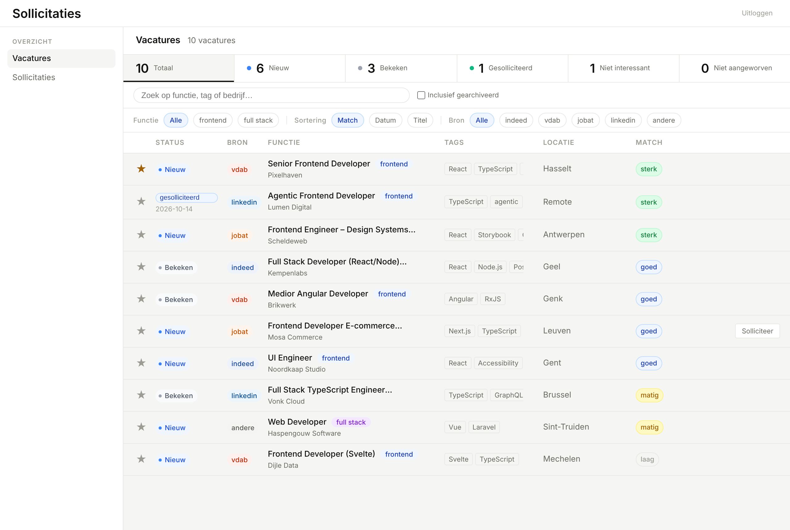
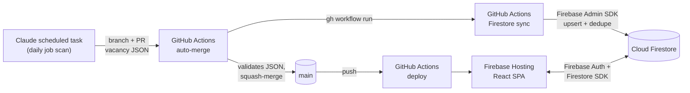

# Sollicitaties-overzicht

A personal job-search and application tracker. Every day a Claude agent searches for
new frontend roles, which flow into Firestore through a fully automated GitHub Actions
pipeline. A React app is where I review them, track my applications and archive what
doesn't fit.

It's a small product built the way a production app should be: type-safe routing,
enforced module boundaries, end-to-end tests against the Firebase emulators, CI/CD, and
an AI agent as a first-class part of the data flow.



<sub>Screenshot taken against the Firebase emulators with fictitious data.</sub>

> The UI and commit messages are in Dutch; the code is in English.

---

## How it works



1. **Scan (Claude).** A scheduled Claude task browses job sites with a Playwright
   browser. It filters on my profile (frontend/full-stack, region, permanent contract,
   AI-assisted development) and skips anything I previously marked as "not
   interesting", which it reads straight from Firestore.
2. **Data as code.** The result is a single versioned JSON file, the one source of
   truth for vacancies. The agent never pushes to `main`; it opens a pull request.
3. **Gated auto-merge.** A PR that changes *only* that file and passes schema
   validation is merged automatically. If a PR touches any other file, it waits for
   human review.
4. **Sync.** A workflow idempotently upserts the file into Firestore (Admin SDK,
   service account stored as a secret) and then reports duplicates.
5. **App.** In the web app I filter, sort and review vacancies, track applications,
   and archive roles that don't fit, with a reason the next scan takes into account.

## Tech stack

| Layer | Choice |
| --- | --- |
| UI | React 19, CSS Modules with design tokens |
| Routing | TanStack Router: file-based routes, loaders, Zod-validated search params, preload on intent |
| Validation | Zod schemas as the domain model, plus mappers between Firestore and the domain |
| Backend | Firebase Auth, Cloud Firestore (security rules), Firebase Hosting |
| Toolchain | Vite+ (`vp`): Rolldown build, Oxlint, tsgo type-check, Vitest |
| Architecture | Sheriff: enforced module boundaries between routes, features, layout, UI and lib |
| Testing | Vitest + Testing Library (co-located), Playwright e2e against the Firebase emulators |
| CI/CD | GitHub Actions: CI, deploy, auto-merge and Firestore sync |
| AI | Claude (scheduled job scan) and Claude Code (development through PRs) |

## Technical highlights

### GitHub Actions as the backend

There is no custom server. Four workflows together act as the backend:

- **`ci.yml`**: on every PR: CSS lint → `vp check` (Oxlint + type-check) → Sheriff →
  unit tests → build. A separate e2e job runs with Java and the Firestore emulator.
  Data-only PRs skip CI via `paths-ignore`.
- **`auto-merge-vacature-sync.yml`**: checks which files changed, validates the JSON,
  squash-merges, then explicitly triggers the sync. That explicit trigger is needed
  because a merge made with `GITHUB_TOKEN` doesn't start new workflows.
- **`sync-firestore.yml`**: `concurrency` guarantees two syncs never run at once. The
  service account only exists for the duration of the run (`umask 077`, removed in an
  `always()` step). The dedupe check runs as a dry run by default.
- **`deploy.yml`**: builds and deploys to Firebase Hosting on every push to `main`.

### Firebase integration

- Firestore security rules restrict reads and writes to a single authenticated user.
- The client uses the modular Firebase SDK; scripts and CI use `firebase-admin`.
- Archived vacancies are only loaded when a filter needs them. The status counters
  come from server-side aggregations (`getCountFromServer`), not from in-memory data.
- The e2e tests run entirely against the **Firebase emulators** (Auth + Firestore)
  with fixed seed data. Production data is never touched, and CI needs no secrets for
  them.

### Frontend

- File-based routing with TanStack Router. Search params (filters, sorting, search
  term) are validated with Zod, so every view can be shared by URL.
- Infinite scroll through a custom `useInfiniteList` hook (IntersectionObserver plus
  loading ahead when the browser is idle). Filtering and sorting happen client-side on
  the loader data.
- Deliberately no `staleTime` on the list: navigating back shows the cached data
  immediately while it revalidates in the background.
- Smart/dumb component split. Sheriff enforces the boundaries in CI: features can't
  import each other, and `lib` stays free of UI code.

### Working with Claude

Claude isn't just in the editor; it's part of the system:

- **As an agent in the pipeline.** The daily scan is a scheduled Claude task that
  searches, filters, rewrites the vacancy file, generates an overview PDF and opens a
  PR. The guardrails live in the pipeline itself (schema validation, auto-merge that
  only applies to data), not in trust.
- **As a pair programmer.** Features and fixes are built with Claude Code on separate
  branches, through PRs that go through the same CI as any other change.
- **Agent instructions as documentation.** `CLAUDE.md`, `AGENTS.md` and `docs/`
  describe the architecture, git workflow and test strategy. They work as onboarding
  for people and as context for agents.

## Running locally

Requirements: Node 24, and Java 21 (only for the Firestore emulator used by e2e tests).

```bash
npm install
cp .env.example .env      # fill in the VITE_FIREBASE_* values
npm run dev               # dev server (vp dev)
```

| Command | What it does |
| --- | --- |
| `npm test` | unit and component tests (Vitest) |
| `npm run test:e2e` | Playwright against the Firebase emulators |
| `npm exec vp check` | lint + type-check |
| `npm run lint:sheriff` | verify module boundaries |
| `npm run lint:css` | Stylelint |
| `npm run build` | production build |
| `npm run trigger:sync` | start the Firestore sync on GitHub and follow the run |

## Project structure

```
app/
  routes/          file-based routes (composition root)
  components/
    vacancies/     feature: review, apply to and archive vacancies
    applications/  feature: application overview
    login/         feature: authentication
    layout/        app shell, header, navigation
    elements/      reusable UI components
  lib/             domain: Zod schemas, Firestore mappers, filter logic, hooks
e2e/               Playwright specs + emulator seed
scripts/           sync, dedupe, migrations, PDF generation (Node + firebase-admin)
docs/              architecture, git workflow, sync and test strategy
.github/workflows/ CI, deploy, auto-merge, Firestore sync
```
